<div align="center">

# 📡 Python SDR Transceiver

### An End-to-End Digital Communication Chain on ADI PlutoSDR

*Built as part of the **Digital Communication (DCCT)** course at **IIT Dharwad***


</div>

---

## 📖 Overview

This repository contains a complete **transmitter and receiver chain** implemented in Python and run over the air on the **Analog Devices ADALM-Pluto SDR**. It was built step by step across the lab sessions of the DCCT course at **IIT Dharwad**, starting from basic noise analysis and ending with a coded, synchronized, pulse-shaped transceiver.

**Highlights**

- 🔹 Multiple modulation schemes: ASK, 4-ASK, 4-PSK, 4-QAM, rotated 4-PSK
- 🔹 Pulse shaping with cosine and raised cosine pulses, and matched filtering at the receiver
- 🔹 Carrier frequency offset (CFO) estimation and correction
- 🔹 Frame synchronization using a **Barker-3 preamble**
- 🔹 Error control with **repetition coding** and **Hamming (7,4)** coding
- 🔹 Real-time transmission and reception on PlutoSDR

---

## 🧩 System Architecture

### Transmitter


### Receiver

```mermaid
flowchart LR
    H["PlutoSDR RX"] --> I["Matched<br/>Filter"]
    I --> J["CFO Estimation<br/>& Correction"]
    J --> K["Frame Sync<br/>(Barker-3 Correlation)"]
    K --> L["Symbol Timing<br/>& Downsampling"]
    L --> M["Phase<br/>Correction"]
    M --> N["Demapper /<br/>Detector"]
    N --> O["Repetition<br/>Decoder"]
    O --> P["Hamming (7,4)<br/>Decoder"]
    P --> Q["Recovered Bits"]

    style H fill:#fde8e8,stroke:#d62728,color:#000
    style Q fill:#e8f4fd,stroke:#1f77b4,color:#000
```



---

## 🧪 Lab-by-Lab Progression

| Lab | Topic | What was implemented |
|:---:|-------|----------------------|
| **1** | Noise Analysis | Studying noise behavior in received signals |
| **2** | Carrier Frequency Offset (CFO) | Estimating and understanding CFO effects |
| **3** | Noise Modelling | Modelling channel noise statistically |
| **4** | Pulse Shaping, Probability of Error, Multilevel ASK | Pulse shaping, BER analysis, multilevel ASK |
| **5** | 4-ASK and Envelope Detection | 4-level ASK with non-coherent envelope detection |
| **6** | 4-PSK, 4-QAM, Rotated 4-PSK | Phase and quadrature modulation schemes |
| **7 & 8** | Cosine and Raised Cosine Pulses | Pulse shaping, **frame synchronization** with a **Barker-3 preamble**, and **matched filtering** |
| **9** | Channel Coding | Everything above combined with **repetition coding** and **Hamming (7,4)** coding |

---

## 🔬 Key Concepts

<details>
<summary><b>Pulse Shaping and Matched Filtering</b></summary>

Cosine and raised cosine pulses limit signal bandwidth and control inter-symbol interference (ISI). A matched filter at the receiver maximizes the signal-to-noise ratio at the sampling instant.

</details>

<details>
<summary><b>Frame Synchronization with Barker-3</b></summary>

A short Barker-3 preamble (`+1 +1 -1`) is prepended to every frame. The receiver correlates the incoming samples with this sequence and locates the correlation peak to find the start of the frame.

</details>

<details>
<summary><b>Carrier Frequency Offset (CFO)</b></summary>

The transmitter and receiver oscillators never match exactly, so the received constellation rotates over time. CFO is estimated and corrected before detection.

</details>

<details>
<summary><b>Channel Coding</b></summary>

- **Repetition code:** each bit is repeated and decoded by majority vote.
- **Hamming (7,4):** 4 data bits are encoded into 7 bits, which lets the receiver correct any single-bit error per block.

</details>

---

## 🛠️ Requirements

**Hardware**
- ADI ADALM-Pluto SDR (with USB cable and antennas)

**Software**
- Python 3.x
- `numpy`, `scipy`, `matplotlib`
- `pyadi-iio` (and `libiio`) for talking to the Pluto

```bash
pip install numpy scipy matplotlib pyadi-iio
```

---

## 🚀 Getting Started

```bash
# 1. Clone the repository
git clone https://github.com/ratnawatlove-wq/python-sdr-transceiver.git
cd python-sdr-transceiver

# 2. Connect the PlutoSDR over USB

# 3. Run the transmitter and receiver scripts
#    (replace with your actual script names)
python transmitter.py
python receiver.py
```

> 💡 The Pluto is usually reachable at `ip:192.168.2.1` or `usb:` once the drivers are installed.

---

## 📚 Documentation and Resources

- 📘 [PlutoSDR Documentation (PySDR)](https://pysdr.org/content/pluto)

---

## 🎓 Acknowledgements

Developed as part of the **Digital Communication (DCCT)** course at the **Indian Institute of Technology Dharwad**.

---

<div align="center">

⭐ If you found this project useful, consider giving it a star!

</div>
